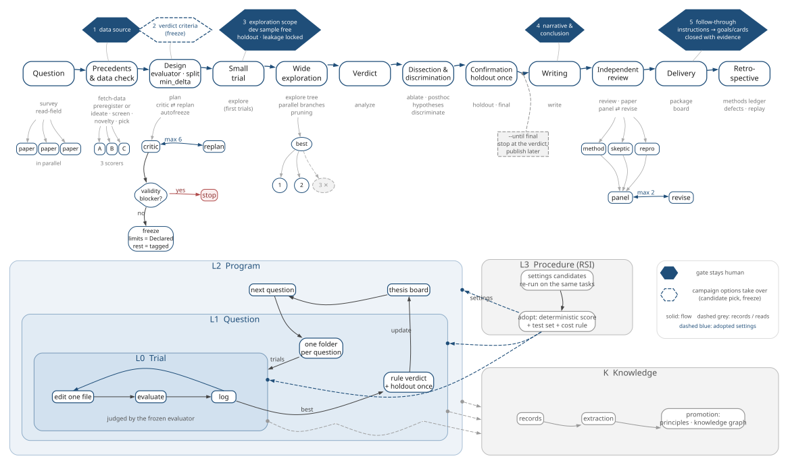
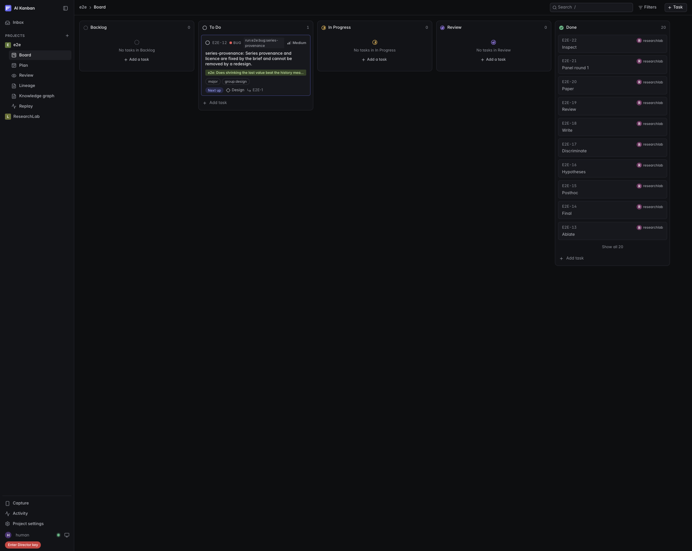
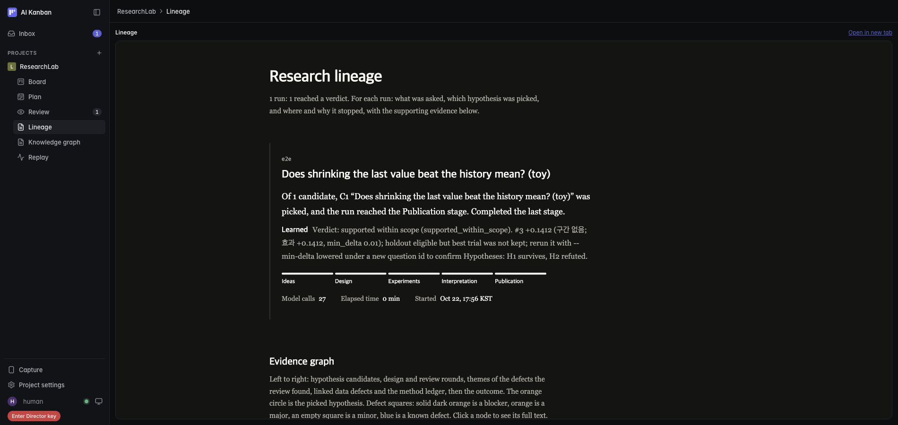
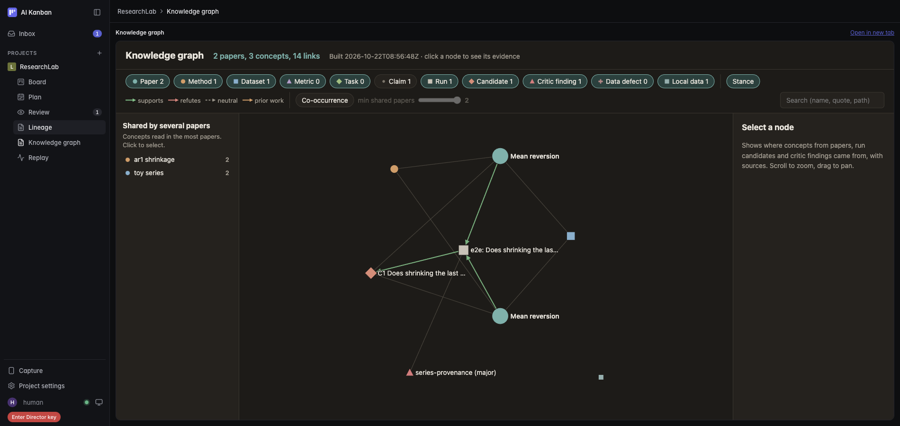
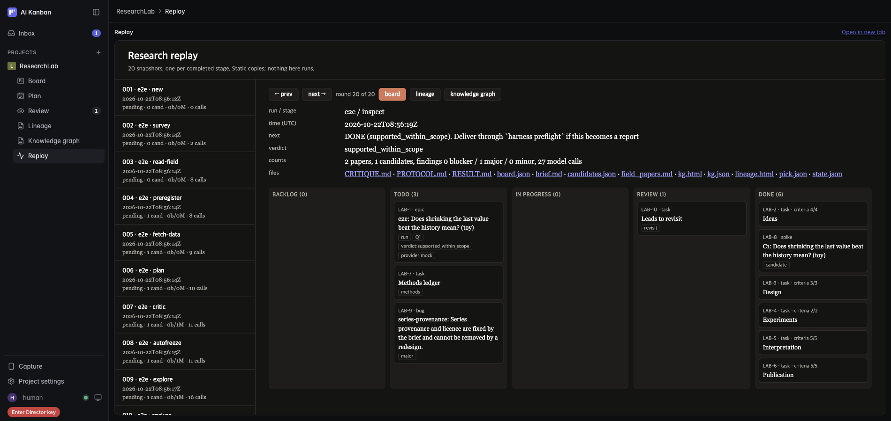

# ResearchLab

연구 질문 하나를 넣으면, 논문을 읽고, 실험을 설계하고, 실험을 돌려서, 검토된 결과 문서까지 만듭니다.
시험하려면 `researchlab init mylab`, `cd mylab`, `researchlab demo`를 차례로 칩니다. 모델은 필요 없습니다.
기록은 `runs/<id>/`에 쌓이고, 진행은 칸반 화면(Board, Lineage, Knowledge graph, Replay)에 나타납니다.

결과가 좋은지 나쁜지는 규칙이 정합니다. 모델은 판정하지 않습니다.
모델(codex, claude)은 읽기, 설계, 코드 작성, 비평에만 씁니다.
파이썬 표준 라이브러리만 씁니다(3.10 이상). 설계 원칙은 `PROTOCOL.md`에 있습니다.

## 시스템 구조
### 역할
모델을 부르는 단계는 세 역할 중 하나가 맡습니다. 기본값은 다음과 같습니다.

| 역할 | 하는 일 | 기본 CLI | 권한 |
|---|---|---|---|
| 자료 담당(data engineer) | 공개 자료를 받고 스냅숏을 만듭니다. (`fetch-data`, `snapshot`) | codex | 쓰기, 네트워크 |
| 연구자(researcher) | 조사, 아이디어, 설계, 실험 코드, 논문 작성. (`survey`, `plan`, `explore`, `write`, `paper` 등) | codex | 쓰기 |
| 검토자(reviewer) | 후보 거르기, 설계 비평, 결과 검토, 패널 심사. (`screen`, `critic`, `review`, `panel`) | claude | 읽기만 |

- 역할의 CLI, 모델, 지침 파일(`prompts/roles/*.md`)과 단계별 담당은 `harness.json`의 `roles`와 `stages`에서 바꿉니다.
- 설계한 쪽과 검토하는 쪽이 다른 모델이 되도록 나눕니다. 연구자가 쓴 글은 검토자가 읽습니다.

### 다음 단계는 파일이 정합니다
- 디렉터(`researchlab next`)는 실행 폴더에 어떤 산출물이 없는지 봅니다. 없는 것을 만드는 단계가 다음 단계입니다.
- 예: `field.md`가 없으면 `survey`. `candidates.json`이 없으면 `ideate`. `pick.json`이 없으면 사람이 후보를 고릅니다. `PROTOCOL.md`가 없으면 `plan`.
- 진행 상태를 따로 저장하지 않습니다. 멈춘 실행은 같은 명령으로 이어 가고, 끝난 단계는 건너뜁니다.
- `researchlab next`는 모델을 부르지 않습니다. `campaign`이 이 판단을 반복해 끝까지 돌립니다.

### 판정은 규칙이 합니다
`lab/rloop.py`가 실험 루프를 맡습니다. 모델은 이 규칙을 바꾸지 못합니다.
- 동결: 평가기와 고정 파일의 해시를 기록합니다. 해시가 바뀌면 다음 시행과 확인 표본 평가를 거부합니다.
- 채택: 시행 하나는 바꿀 파일 하나를 고쳐 평가기를 한 번 돌립니다. 직전 최고보다 `min_delta`를 넘어야 채택(keep)합니다.
- 확인 표본(holdout): 질문당 한 번만 엽니다. 개발 최고안과 기준선을 함께 평가합니다. 다시 열기는 거부합니다.
- 판정은 네 가지 중 하나입니다.

| 판정 | 뜻 |
|---|---|
| `invalid` | 평가나 설정이 유효하지 않아 비교할 수 없습니다. |
| `no_improvement` | 효과가 없거나 기준선보다 나빠졌습니다. |
| `inconclusive` | 확인 표본의 효과 구간이 개선, 동등, 악화 중 어느 쪽도 확정하지 못합니다. |
| `supported_within_scope` | 선언한 범위 안에서 확인 표본에서도 개선이 확인됩니다. |

### 화면은 파일의 뷰입니다
- Board(칸반), Lineage, Knowledge graph, Replay는 모두 작업 공간의 파일에서 만든 화면입니다.
- 칸반 카드는 실행 폴더를 읽어 맞춥니다. 계보는 `lineage.json`, 지식 그래프는 `kg/kg.json`, Replay는 `replay/`에서 옵니다.
- 화면을 지워도 기록은 그대로입니다. `lab.py kanban-sync`, `lab.py lineage`, `lab.py kg`, `lab.py replay`로 다시 만듭니다.

## 작업 공간 구조
`researchlab init mylab`이 만드는 폴더(`LAB_HOME`)와 실행 한 건이 남기는 파일입니다.
```
mylab/
├── harness.json            역할, 단계별 담당, clean 모드, codex 모델
├── prompts/                단계별 지침. 여기에 두면 패키지 기본본보다 먼저 쓰임
├── skills/                 작업 공간 스킬. 같은 규칙으로 먼저 쓰임
├── data/<name>/
│   └── MANIFEST.json       자료 출처, 라이선스, 파일별 해시
├── papers/<id>/
│   ├── paper.md            논문 본문(텍스트)
│   ├── card.json           논문 요약 카드(주장, 방법, 자료, 한계)
│   └── meta.json           제목, 저자, 출처
├── kg/                     지식 그래프(kg.json, kg.html)
├── replay/                 단계마다 찍은 상태 사진
├── lineage.html            실행 계보 화면 (lineage.json이 원본)
└── runs/<id>/
    ├── brief.md            질문과 사전 등록 설계
    ├── field.md            분야 지도와 선행연구
    ├── field_papers.md     읽은 논문 목록과 근거
    ├── candidates.json     후보 가설
    ├── pick.json           고른 후보
    ├── data_plan.json      필요한 자료 계획
    ├── critique.json       설계 비평(CRITIQUE.md는 읽기용)
    ├── exp/                실험 폴더
    │   ├── PROTOCOL.md     실험 규약
    │   ├── evaluate.py     동결된 평가기
    │   ├── <바꿀 파일>      시행마다 고치는 파일 (예: estimator.py)
    │   ├── data/           실행에 복사된 자료(해시 검증)
    │   └── results.tsv     시행마다 한 줄: 점수, keep/discard
    ├── RESULT.md           결과와 한계
    ├── REVIEW.md           검토자 의견
    ├── paper/              논문 초안
    ├── calls.jsonl         모델 호출 기록(지문)
    └── events.jsonl        단계 이벤트와 멈춘 이유
```

## 설치
```
python -m pip install --no-index researchlab-*.whl     # 이 zip 맨 위의 wheel. 네트워크가 필요 없습니다.
```
- 소스로 설치하려면 `python -m pip install ./ResearchLab`을 씁니다.
- 설치 없이 쓰려면 이 폴더에서 `python3 lab.py ...`를 씁니다. Windows는 `lab.cmd ...`를 씁니다.
- Windows는 Python 3.10 이상이 필요합니다. `winget install Python.Python.3.12`로 설치합니다.
- Node 22.13 이상은 칸반 화면에만 필요합니다. `winget install OpenJS.NodeJS.LTS`로 설치하고 새 터미널을 엽니다.
- Node가 없어도 나머지는 모두 동작합니다.

## 5분 확인 (모델 없이)
```
researchlab init mylab      # 작업 공간을 만들고 칸반을 띄웁니다. 빈 포트를 8790부터 찾습니다.
cd mylab
researchlab doctor          # python, codex, claude, node, 칸반 포트를 점검합니다.
researchlab selftest        # 마지막 줄이 "all selftests ok"이면 정상입니다.
researchlab demo            # 고정 평가기로 상수 하나를 고르는 작은 루프
researchlab demo jev        # 합성 자료로 과제별 판정 문턱을 고르는 루프
```
- 두 데모는 `runs/demo-quickstart`, `runs/demo-jev`에 실행 기록을 남깁니다.
- `init`이 출력한 칸반 주소를 브라우저로 엽니다.
- 사이드바에서 데모 실행의 프로젝트를 고릅니다. 실행마다 프로젝트가 하나 생깁니다. 카드는 실험 단계에서 멈춥니다.
- Lineage에서 데모 실행이 계보에 올라온 것을 봅니다.
- 작업 공간은 `LAB_HOME`입니다. 없으면 현재 폴더에서 위로 올라가며 `harness.json`이 있는 폴더를 찾습니다.
- `prompts/`와 `skills/`에 파일을 두면 패키지 기본본보다 먼저 쓰입니다.

## 실제로 돌리기
먼저 `codex`와 `claude` CLI를 설치하고 로그인합니다. 역할별 모델은 `harness.json`에서 정합니다.
```
researchlab new r1 "질문을 한두 문장으로" --exp-dir exp-r1   # 새 실행. exp-dir은 작업 공간 안이어야 합니다.
researchlab next r1                                          # 다음에 칠 명령 하나를 알려 줍니다. 모델을 부르지 않습니다.
researchlab campaign r1 --auto-pick --auto-freeze            # 사람이 할 단계를 빼고 끝까지 돌립니다.
```
`campaign` 옵션은 다음과 같습니다.

| 옵션 | 뜻 | 기본 |
|---|---|---|
| `--auto-pick` | 뻔하지 않고 선행연구가 없는 최상위 후보를 고릅니다. 이 옵션이 없으면 사람이 `pick`으로 고릅니다. | 끔 |
| `--auto-freeze` | 비평이 깨끗하면 설계를 스스로 동결합니다. 이 옵션이 없으면 사람이 `freeze`로 동결합니다. | 끔 |
| `--replan-rounds N` | 비평과 재설계를 최대 N번 돕니다. | 6 |
| `--wall-min M` | M분이 지나면 멈춥니다. | 240 |
| `--max-stages N` | 단계를 N번 실행하면 멈춥니다. | 60 |
| `--max-chars N` | 모델에 보내는 글자 수의 합계 상한입니다. | 20000000 |
| `--pivots N` | 결과가 없거나 불확실하면 다른 후보로 N번 다시 시작합니다. | 0 |

멈춘 `campaign`은 같은 명령으로 이어 갑니다. 이미 끝난 단계는 건너뜁니다.

### 실제 자료 데모
```
python -m pip install numpy          # 이 데모만 numpy가 필요합니다.
researchlab demo gerber              # 자료와 실행(runs/demo-gerber)만 준비하고 다음 명령을 출력합니다.
researchlab demo gerber --run        # 준비하고 바로 campaign까지 돌립니다.
```
사전 등록된 설계는 들어 있습니다. 공개 저장소에는 자료 파일(`returns.tsv.gz`, `universe.json`)이 들어 있지 않습니다. 두 파일을 `lab/defaults/examples/gerber/data/`에 두면 같은 데모가 돕니다(해시는 `MANIFEST.json`). 자료는 해시를 검증한 뒤 `data/kr_a200_dev`에 복사됩니다. 이 데모는 모델을 씁니다.

## 단계 흐름


```
survey            분야 지도와 선행연구
  v
read-field        논문 본문을 읽고 papers/ 아래에 저장. 인용문은 원문과 대조해 검증
  v
brief에 "## Pre-registered design"이 없으면      있으면
  ideate -> screen -> novelty -> pick            preregister (후보 1개, 신규성, 선택)
  v
fetch-data        공개 자료만 받고 MANIFEST를 검증. data/에 이미 있으면 "있음"으로 등록
  v
plan              PROTOCOL.md, evaluate.py, 바꿀 파일 초안
  v
critic <-> replan 비평과 재설계를 반복 (아래 "막혔을 때")
  v
autofreeze        평가기와 확인 표본을 동결 (--auto-freeze 없으면 사람이 freeze)
  v
explore           트리 탐색. 시행을 병렬로 돌림 (개발 표본)
  v
analyze           확인 표본을 한 번 열고 규칙으로 판정
  v
ablate, final, posthoc, hypotheses, discriminate
  v
write -> review -> paper -> panel <-> revise
```
- 반복하는 곳: `critic <-> replan`, `panel <-> revise`(기본 2회).
- 병렬로 도는 곳: `read-field`(논문별), `explore`(시행별, `--workers`), `panel`(리뷰어별).
- 사람이 하는 곳: 후보 선택, 동결. `campaign`의 두 옵션이 이를 대신합니다.
- 각 단계 뒤에 `researchlab next`가 다음 단계를 알려 줍니다.

## 막혔을 때
- 비평 반복: `critic`과 `replan`은 `--replan-rounds`까지 돕니다. 지적이 줄지 않으면 일찍 멈춥니다.
- 예산: `--wall-min`, `--max-stages`, `--max-chars` 중 하나가 닿으면 멈춥니다. 이벤트에 이유가 남습니다.
- 대체 모델: 한 단계가 두 번 실패하면 다른 모델(provider)로 바꿔 다시 합니다.
- 논문 읽기: `read-field`는 alpha가 안 되면 arXiv로 넘어갑니다.
- 꼬리표를 달고 진행:
  - 비평이 끝까지 해소되지 않아도 막지 않고 동결합니다.
  - 해소되지 않은 지적은 `PROTOCOL.md`의 "Unresolved at freeze (tagged)" 절에 적습니다.
  - 판정에 꼬리표가 붙고, `RESULT.md`가 한계 목록을 적습니다.
- 그래도 멈추는 경우(유효성 차단):
  - 개발 표본 평가가 실패합니다.
  - 점수가 바꿀 파일을 무시합니다.
  - 기준선이 유효하지 않습니다.
- 자료의 한계(이전 탐색, 생존 편향 등)는 선언하면 자동으로 받아들입니다. 선언은 결과에 남습니다.
- 멈춘 이유는 `runs/<id>/events.jsonl`과 Lineage 화면에서 봅니다.

## 화면
칸반 주소에서 프로젝트를 열면 다음 화면이 있습니다. 아래 그림은 모델 없이 합성 자료로 돌린 예시 실행입니다.

| 화면 | 보여 주는 것 |
|---|---|
| Board | 실행마다 프로젝트 1개: 에픽, 단계마다 카드 1장(비평·리뷰는 회차마다), 비평 지적은 bug 카드. 공통 카드(방법 장부, 자료 결함)는 ResearchLab 프로젝트. 막힌 단계는 Review 칸에 놓입니다. |
| Plan | 단계 계획과 진행 |
| Review | 사람이 봐야 할 것 |
| Lineage | 실행마다 무엇을 물었고, 무엇을 골랐고, 왜 멈췄는지. 실행 계보, 단계별 소요 시간, 임계경로 |
| Knowledge graph | 읽은 논문, 개념, 지지·반박 화살표. 필터로 좁힙니다. 노드를 누르면 근거가 나옵니다. |
| Replay | 단계마다 찍은 상태 사진. 이전·다음 버튼으로 넘깁니다. |


Board: 실행 하나가 프로젝트 하나입니다. 단계 카드가 칸을 옮겨 가고, 비평 지적은 bug 카드로 남습니다. 카드 종류는 조사·후보 spike, 데이터 chore, 설계·실험 feature, 비평 회차·서술 task, 지적 bug입니다.


Lineage: 무엇을 물었고, 어떤 후보를 골랐고, 판정이 무엇인지 한 장에 보여 줍니다.


Knowledge graph: 논문, 개념, 후보, 비평 지적이 화살표로 이어집니다. 노드를 누르면 근거가 나옵니다.


Replay: 단계마다 찍은 상태를 왼쪽 목록에서 고르고, 그때의 보드를 다시 봅니다.

- 화면은 단계가 끝날 때마다 자동으로 갱신됩니다. 끄려면 `LAB_KANBAN_AUTO=0`입니다.
- 칸반은 `researchlab init`이 띄웁니다. 다시 띄우려면 `lab.py kanban-up`, 끄려면 `lab.py kanban-down`입니다.
- 지식 그래프는 `lab.py kg`로, 계보는 `lab.py lineage`로, Replay는 `lab.py replay --open`으로 다시 만듭니다.
- Replay 기록을 끄려면 `LAB_REPLAY=0`입니다.

## 지키는 것
- 평가기 해시를 고정합니다. 해시가 바뀌면 다음 시행을 거부합니다.
- 확인 표본은 질문당 한 번만 엽니다. 다시 열기는 코드가 거부합니다.
- 음성 결과도 장부에 남깁니다.
- 판정은 규칙(판정 사다리)이 합니다. 점수가 올랐다는 이유만으로 채택하지 않습니다.
- 바꿀 파일의 민감도를 점검합니다. 바꿀 파일을 바꿔도 점수가 변하지 않으면 실험을 막습니다.

## 격리와 깨끗한 모드
작업 공간 안에서만 읽고 씁니다.
- 새 실행은 평가기와 실험 파이썬이 작업 공간 밖 파일을 읽지 못하게 막습니다. 막은 시도는 이벤트로 남습니다.
- 실험 폴더(`--exp-dir`)는 작업 공간 안에 있어야 합니다. 밖에 두려면 `new --allow-outside`를 쓰되, 그러면 가드가 꺼집니다.
- `RLOOP_GUARD=0`은 가드를 끄고 `1`은 강제로 켭니다.

기본은 깨끗한 모드입니다(`harness.json`의 `"clean": true`). 결과가 쓰는 사람의 개인 설정에 흔들리지 않게 합니다.
- 꺼지는 것: 사용자 설정 파일, 플러그인, 훅, 메모리, MCP 서버, 사용자 스킬. 로그인은 그대로 씁니다.
- codex 모델과 추론 강도는 `harness.json`의 `codex_model`, `codex_effort`로 고정합니다.
- 모델 호출마다 `runs/<id>/calls.jsonl`에 지문이 남습니다. CLI 버전, 실제 모델, clean 여부, 개인 설정 파일의 해시 앞 12자입니다. 파일 내용은 남기지 않습니다.
- 개인 설정을 쓰려면 `"clean": false`로 바꿉니다.

한계:
- 모델 CLI는 절대경로로 작업 공간 밖 파일을 읽을 수 있습니다. 환경변수의 비밀(KEY, TOKEN)은 빼고 임시 폴더에서 돌리지만, 샌드박스는 쓰기만 제한합니다.
- codex는 홈의 전역 지침 파일을 끌 방법이 없습니다. 지문에 `suppressed: false`로 남습니다.
- claude는 실행 폴더의 프로젝트 설정과 CLAUDE.md를 읽습니다.
- 두 CLI에 들어 있는 기본 스킬은 남습니다.
- 모델 답변이 작업 공간 밖 경로를 말하면 이벤트로 기록할 뿐 막지 않습니다.

## 내장 스킬과 외부 스킬
내장 스킬 5개가 연구 요령을 담습니다. 형식은 `SKILL.md`입니다.
- `research-data`: 시점 고정 스냅숏, 미래 참조·생존 편향 점검, 자료 결함 장부.
- `evaluator-design`: 평가기 동결, 단순 기준선, 확인 표본 1회.
- `experiment-stats`: 부트스트랩 구간, Holm 보정, 판정 사다리.
- `critique-checklist`: 지적 분류와 심각도(blocker, major, minor, known).
- `research-writing`: 판정 강도만큼만 주장, 숫자는 장부에서.

외부 스킬 3개를 원 라이선스와 함께 싣습니다. 출처와 커밋은 `lab/defaults/skills/THIRD_PARTY.md`에 있습니다.
- `backtesting-frameworks` (MIT)
- `statistical-analysis` (Apache-2.0)
- `validate-data` (Apache-2.0)

```
researchlab skills             # 목록
researchlab skills install     # 작업 공간의 .claude/skills, .agents/skills에 복사
```
모델 호출 때는 스킬이 자동으로 보입니다. `install`은 이 폴더에서 직접 연 claude·codex 세션을 위한 것입니다. 홈 폴더에는 쓰지 않습니다.

## 논문 찾기
`alpha` CLI가 PATH에 있으면 alpha로 찾고 읽습니다. 없으면 arXiv 공개 API와 HTML을 씁니다.
`LAB_PAPERS=arxiv`로 arXiv를 강제합니다. arXiv 요청은 3초 간격으로 하나씩 보냅니다.

## 명령 요약
| 하고 싶은 일 | 명령 |
|---|---|
| 작업 공간 만들기 | `researchlab init DIR` |
| 환경 점검 | `researchlab doctor` |
| 자체 시험 | `researchlab selftest` |
| 데모 | `researchlab demo [quickstart\|jev\|gerber] [--run]` |
| 새 실행 | `researchlab new RUN "질문" --exp-dir DIR` |
| 다음 명령 | `researchlab next RUN` |
| 상태 | `researchlab status RUN` |
| 후보 고르기 | `researchlab pick RUN C1` |
| 무인 진행 | `researchlab campaign RUN --auto-pick --auto-freeze` |
| 단계 하나 | `researchlab survey\|read-field\|plan\|critic\|explore\|analyze\|write\|review RUN` |
| 한 쪽짜리 결과 페이지 | `researchlab inspect RUN` |
| 칸반 켜기·끄기 | `researchlab kanban-up`, `researchlab kanban-down` |
| 스킬 | `researchlab skills [install]` |
| 학회·저널 프로필 | `researchlab venue NAME`, `researchlab venue-profile NAME` |

설치하지 않았다면 `researchlab` 대신 `python3 lab.py`(Windows는 `lab.cmd`)를 씁니다.
